# Vehicle Health Monitoring System (VHMS)

**Distributed Embedded Monitoring • Classical CAN • MQTT • Cloud Backend
• Live Dashboard**

A multi-controller vehicle-monitoring prototype integrating STM32,
Arduino UNO R4 WiFi, NXP FRDM-MCXN236, Adafruit IO, Node.js, Neon
PostgreSQL and WebSockets.


------------------------------------------------------------------------

## 🎥 Demo Video

```{=html}
<!-- Demo video link will be added here when available. -->
```

------------------------------------------------------------------------

## 📚 Table of Contents

1.  [Introduction](#1-introduction)
2.  [Project at a Glance](#2-project-at-a-glance)
3.  [System Architecture](#3-system-architecture)
4.  [Hardware Components](#4-hardware-components)
5.  [CAN Network Design](#5-can-network-design)
6.  [CAN Message Mapping](#6-can-message-mapping)
7.  [End-to-End Data Flow](#7-end-to-end-data-flow)
8.  [MQTT and Adafruit IO](#8-mqtt-and-adafruit-io)
9.  [Backend and Database](#9-backend-and-database)
10. [Web Dashboard](#10-web-dashboard)
11. [Repository Structure](#11-repository-structure)
12. [Setup and Deployment](#12-setup-and-deployment)
13. [Prototype Validation](#13-prototype-validation)
14. [Measurement Notes](#14-measurement-notes)
15. [Additional Photos to Add](#15-additional-photos-to-add)
16. [Future Enhancements](#16-future-enhancements)
17. [Disclaimer](#17-disclaimer)

------------------------------------------------------------------------

# 1. Introduction

The **Vehicle Health Monitoring System (VHMS)** is a distributed
embedded monitoring prototype designed to acquire vehicle-related and
environmental measurements, transmit them over a shared Controller Area
Network (CAN), and make the resulting telemetry available through a
cloud-connected web dashboard.

Three microcontroller platforms form the embedded system:

-   **STM32 NUCLEO-F446RE** -- sensor acquisition and CAN communication.
-   **Arduino UNO R4 WiFi** -- sensor acquisition, CAN reception, and
    MQTT gateway.
-   **NXP FRDM-MCXN236** -- GPS acquisition and native CAN
    communication.

The nodes communicate over a shared **500 kbit/s Classical CAN bus**.
The Arduino gateway groups received CAN frames into JSON snapshots and
publishes them to **Adafruit IO using MQTT over TLS**. A **Node.js
backend** deployed on Render subscribes to the MQTT feed, decodes CAN
payloads, stores readings in **Neon PostgreSQL**, and broadcasts live
telemetry to the browser dashboard through WebSockets.

### Objectives

-   Acquire multiple parameters using distributed microcontrollers.
-   Establish multi-node communication using CAN.
-   Define CAN identifiers and consistent payload encoding.
-   Bridge CAN telemetry to the cloud using MQTT.
-   Decode and store sensor readings in PostgreSQL.
-   Visualize live sensor values and CAN activity in a web dashboard.

------------------------------------------------------------------------

# 2. Project at a Glance

  -----------------------------------------------------------------------
  Area                                Implementation
  ----------------------------------- -----------------------------------
  Embedded controllers                STM32 NUCLEO-F446RE, Arduino UNO R4
                                      WiFi, NXP FRDM-MCXN236

  Vehicle network                     Classical CAN, 500 kbit/s

  CAN identifiers                     Standard 11-bit IDs

  External CAN controller             MCP2515

  External CAN transceiver            TJA1050

  NXP CAN interface                   Integrated FlexCAN and onboard
                                      transceiver

  Sensors                             DHT11, vibration module, INA219,
                                      BMP280, Hall sensor, MQ-2, HC-SR04,
                                      GPS

  Gateway                             Arduino UNO R4 WiFi

  Cloud messaging                     MQTT over TLS, Adafruit IO

  Backend                             Node.js, Express

  Database                            Neon PostgreSQL

  Live transport                      WebSocket

  Hosting                             Render and GitHub Pages
  -----------------------------------------------------------------------

------------------------------------------------------------------------

# 3. System Architecture

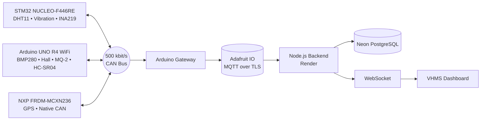

The architecture is divided into four layers:

1.  **Sensor and embedded layer:** sensors connect to their assigned
    microcontrollers.
2.  **Vehicle communication layer:** CAN transports the encoded
    measurements between nodes.
3.  **Cloud and processing layer:** the Arduino gateway publishes MQTT
    snapshots; the Node.js backend decodes and stores them.
4.  **Application layer:** the dashboard receives live telemetry through
    WebSockets.

------------------------------------------------------------------------

# 4. Hardware Components

The following component photos are visual references for the component
types. Exact board revisions and breakout layouts may differ from the
photographs.

## 4.1 Microcontrollers

### Arduino UNO R4 WiFi

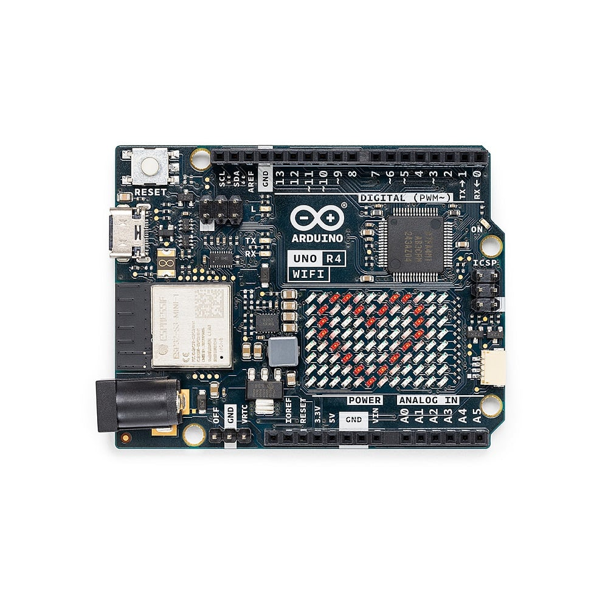

**Role: CAN gateway, sensor node and Wi-Fi interface**

The Arduino UNO R4 WiFi is the bridge between the CAN network and the
cloud. It also reads its locally connected sensors.

-   BMP280 temperature and pressure acquisition.
-   Hall-effect pulse measurement for RPM.
-   MQ-2 analog acquisition.
-   HC-SR04 distance measurement.
-   CAN reception through the MCP2515.
-   MQTT snapshot publishing to Adafruit IO.

**Why it is used:** It combines microcontroller I/O and Wi-Fi
connectivity, making it suitable for the gateway role without a separate
Wi-Fi module.

### STM32 NUCLEO-F446RE

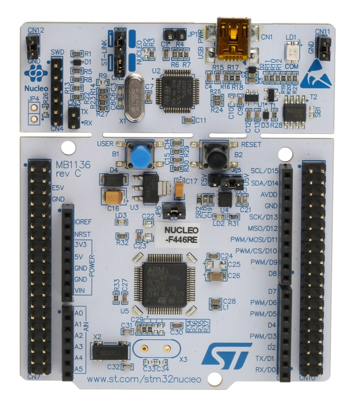

**Role: Sensor acquisition and CAN node**

Connected sensors: - DHT11 temperature and humidity module. - Vibration
sensor module. - INA219 voltage and current monitor.

The STM32 reads the sensors, encodes their measurements, and transmits
CAN frames using an external MCP2515 controller and TJA1050 transceiver.

**Why it is used:** It provides a separate embedded processing node and
demonstrates distributed sensor acquisition over a common vehicle
network.

### NXP FRDM-MCXN236

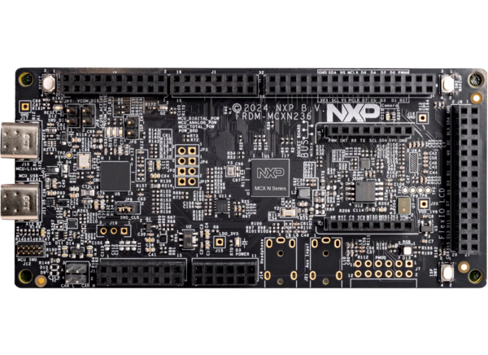

**Role: GPS acquisition and native CAN node**

The NXP board receives GPS NMEA data through UART, extracts speed and
position information, and transmits the information over CAN.

The board uses its integrated FlexCAN controller and onboard CAN
transceiver. It therefore does not require an external MCP2515/TJA1050
module.

**Why it is used:** It demonstrates a controller with native CAN
capability and adds GPS-derived information to the monitoring network.

## 4.2 CAN Interface Components

### MCP2515 CAN Controller Module

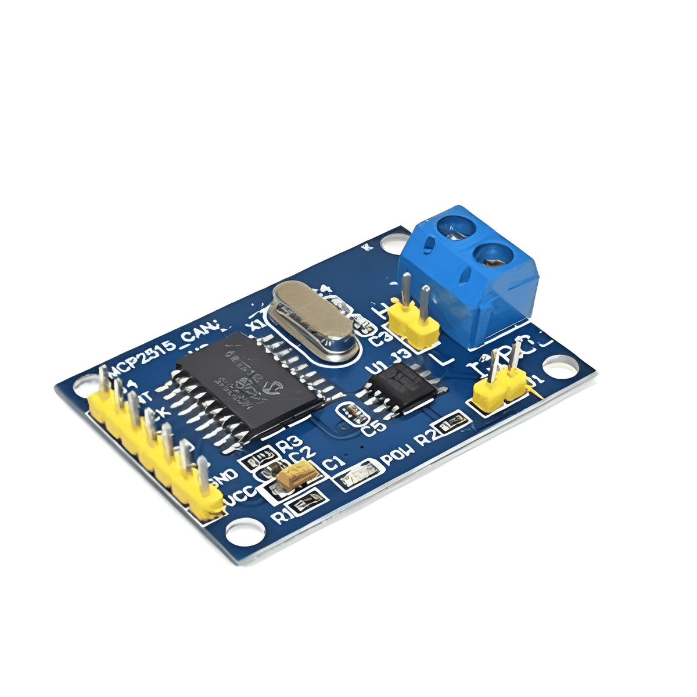

The MCP2515 is a standalone CAN controller that communicates with the
host microcontroller through SPI. It handles CAN frame transmission and
reception, message identifiers, and protocol operations.

It is used by the STM32 and Arduino nodes.

### TJA1050 CAN Transceiver

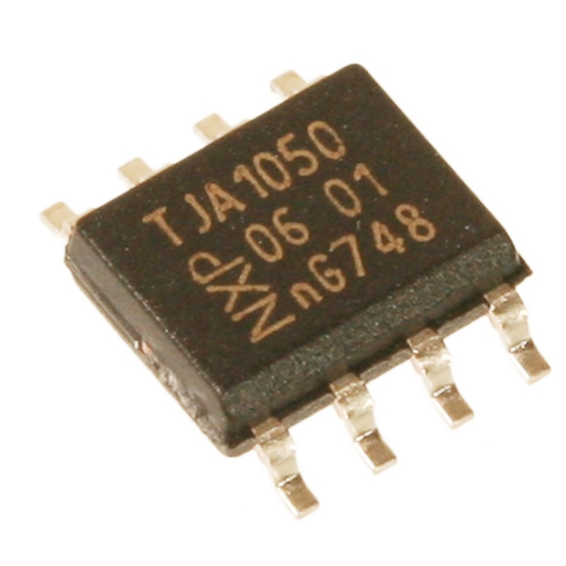

The TJA1050 is a high-speed CAN physical-layer transceiver. It provides
the electrical interface between the controller and the differential
CANH/CANL bus.

### Why MCP2515 and TJA1050 are paired

They perform different functions:

  Device    Function
  --------- ----------------------------
  MCP2515   CAN protocol controller
  TJA1050   Physical-layer transceiver

The microcontroller communicates with the MCP2515 over SPI. The
MCP2515's TXCAN/RXCAN signals connect to the TJA1050. The transceiver
then drives and receives the differential CANH/CANL bus signals.

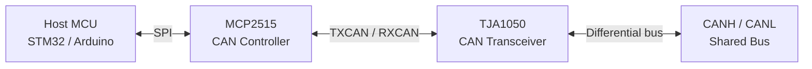

### Why the NXP node does not need an external MCP2515

The FRDM-MCXN236 uses the MCU's integrated **FlexCAN** peripheral as its
CAN controller and the board's onboard CAN transceiver as the
physical-layer interface.

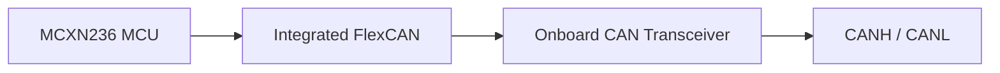

The controller/transceiver functions are still present; they are simply
integrated into the MCU and development board rather than supplied as an
external MCP2515/TJA1050 module.

## 4.3 Sensors

### DHT11 -- Temperature and Humidity

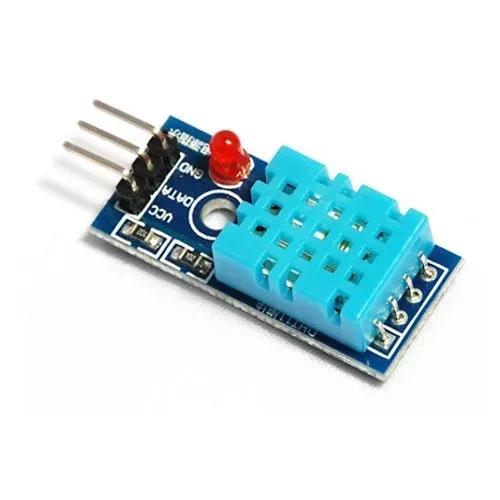

**Connected to:** STM32 NUCLEO-F446RE\
**Interface:** Digital sensor interface

The DHT11 provides ambient temperature and relative humidity. Its
temperature channel is used as a demonstration temperature input for CAN
ID `0x100`.

**Why it is used:** It demonstrates sensor acquisition, value scaling,
CAN encoding, and dashboard display.

### Vibration Sensor Module

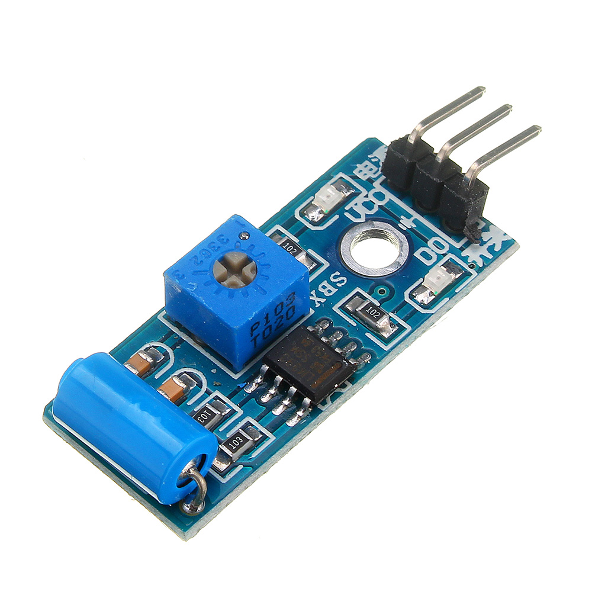

**Connected to:** STM32 NUCLEO-F446RE\
**Interface:** Digital output in the current firmware configuration

The vibration module detects vibration or movement events. The firmware
counts digital output transitions over a time window and transmits a
scaled relative reading.

**Why it is used:** It demonstrates vibration-event acquisition and
transmission through the CAN network.

> The transmitted value is a firmware-derived relative index. It is not
> a calibrated accelerometer measurement in g.

### INA219 -- Voltage and Current Monitor

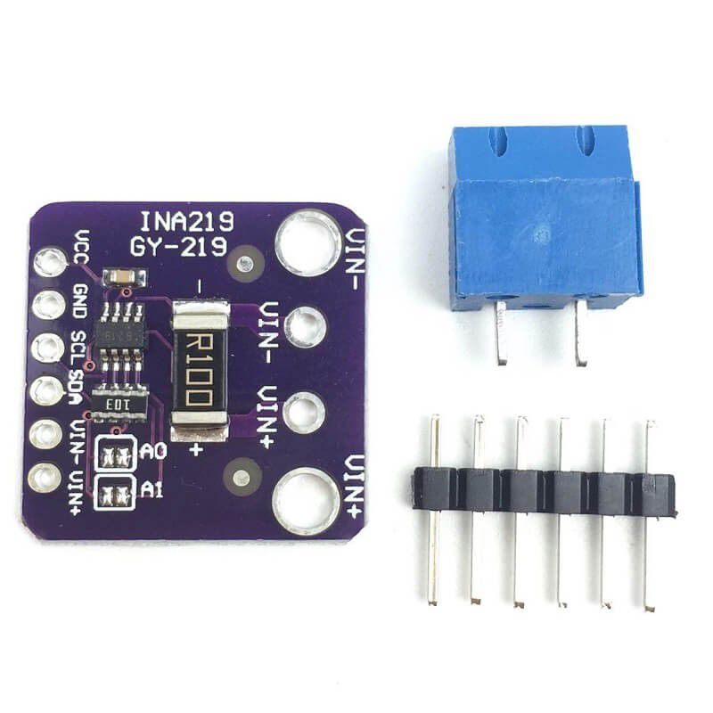

**Connected to:** STM32 NUCLEO-F446RE\
**Interface:** I2C

The INA219 measures bus voltage and current through the monitored load
path. The STM32 encodes the measurements into CAN IDs `0x106` and
`0x107`.

**Why it is used:** Voltage and current are useful parameters for
monitoring the vehicle electrical supply and load behaviour. For current
measurement, the monitored load current must pass through VIN+ and VIN−.

### BMP280 -- Temperature and Pressure

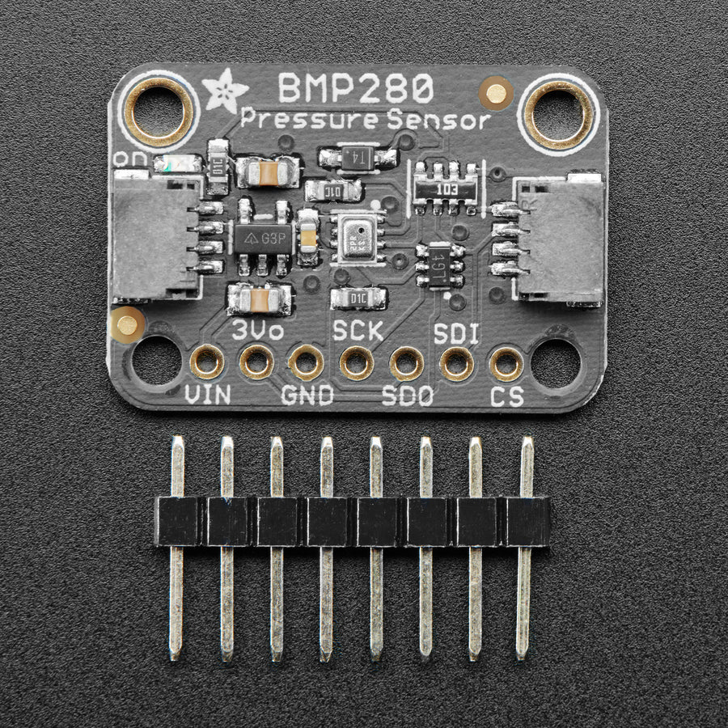

**Connected to:** Arduino UNO R4 WiFi\
**Interface:** I2C

The BMP280 measures ambient temperature and atmospheric pressure. These
are transmitted using CAN IDs `0x103` and `0x104`.

**Why it is used:** It provides environmental measurements through a
compact digital sensor.

> BMP280 measures temperature and pressure; it does not measure
> humidity.

### Hall-Effect Sensor -- Rotational Speed

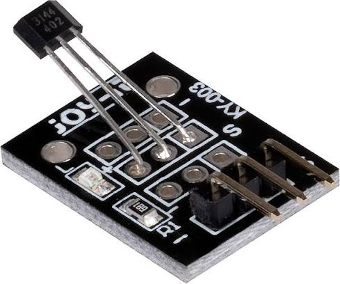

**Connected to:** Arduino UNO R4 WiFi\
**Interface:** Digital pulse input

The Hall-effect sensor detects magnetic pulses from a rotating object.
The Arduino measures the time between pulses and calculates RPM.

The current firmware assumes one pulse per revolution:

\[ RPM = `\frac{60,000,000}{T_{\mu s}}`{=tex} \]

where (T\_{`\mu `{=tex}s}) is the time between pulses in microseconds.

**Why it is used:** It demonstrates pulse-based rotational speed
measurement, a useful type of vehicle parameter.

### MQ-2 -- Gas and Smoke Sensor

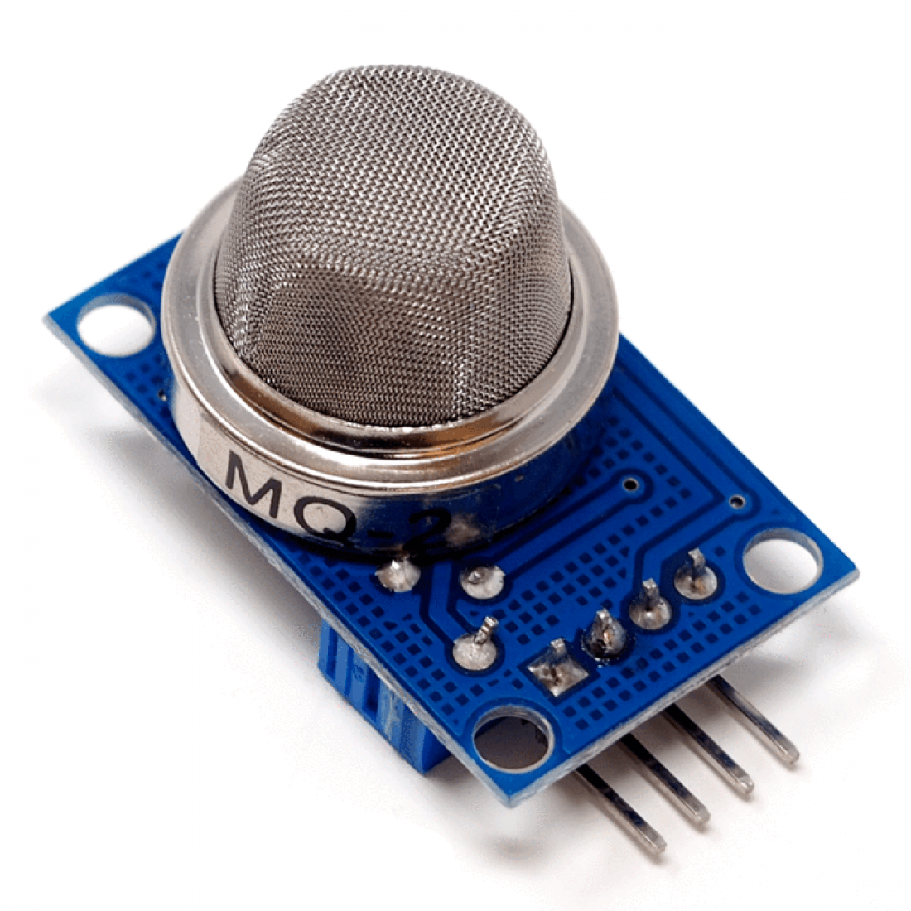

**Connected to:** Arduino UNO R4 WiFi\
**Interface:** Analog input

The MQ-2 produces an analog response that changes with combustible gases
and smoke. The firmware transmits its raw ADC reading using CAN ID
`0x108`.

**Why it is used:** It demonstrates analog sensor acquisition and
transmission of gas-sensor response data.

> The current value is raw ADC output, not a calibrated gas
> concentration in ppm.

### HC-SR04 -- Ultrasonic Distance Sensor

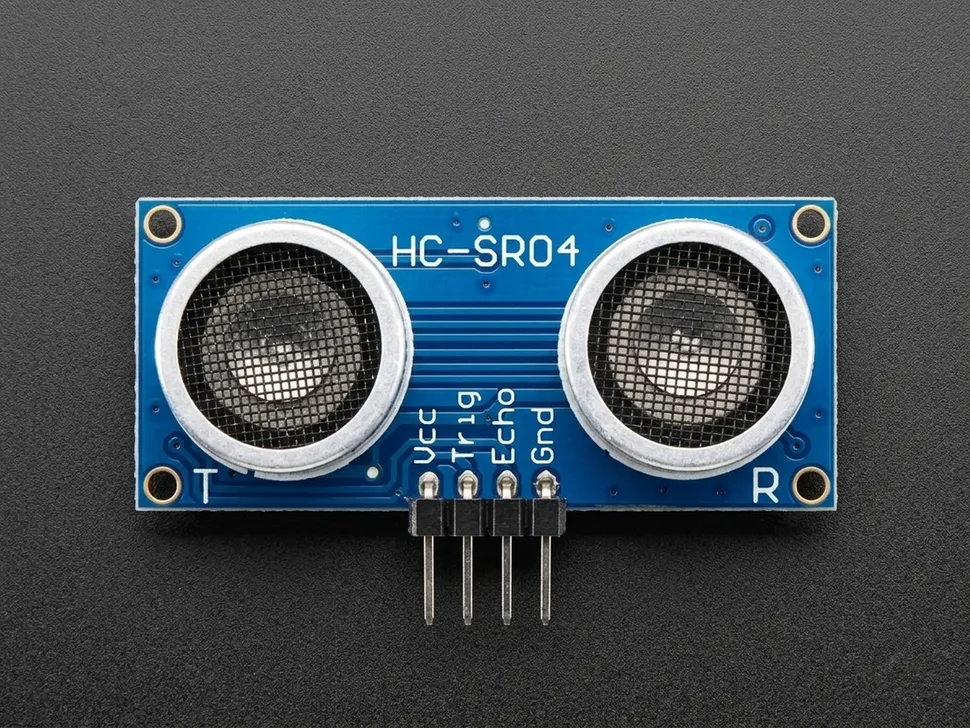

**Connected to:** Arduino UNO R4 WiFi\
**Interface:** Digital trigger and echo

The HC-SR04 measures distance by transmitting an ultrasonic pulse and
measuring the echo return time.

\[ Distance\_{cm} = `\frac{EchoTime_{\mu s}\times0.0343}{2}`{=tex} \]

The firmware sends distance in centimetres multiplied by ten. A value of
`4000` represents the no-echo sentinel, equivalent to 400.0 cm.

**Why it is used:** It demonstrates proximity and distance measurement
as an additional monitoring input.

### GPS Module

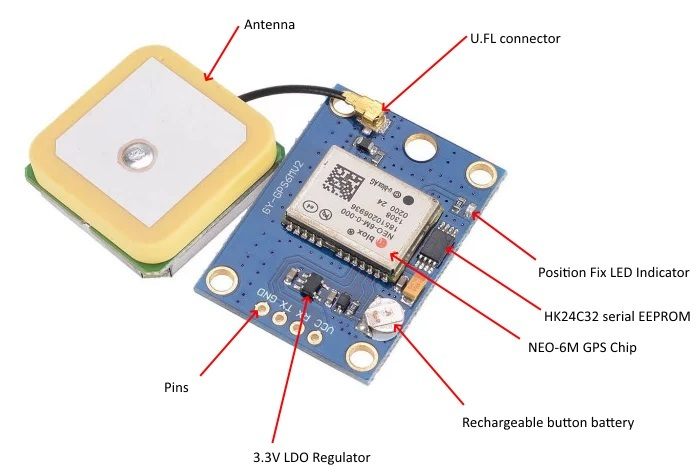

**Connected to:** NXP FRDM-MCXN236\
**Interface:** UART using NMEA messages

The GPS module supplies navigation data. The NXP firmware extracts speed
and position and transmits them over CAN.

-   `0x105` -- GPS speed.
-   `0x10B` -- GPS latitude and longitude.

GPS messages are sent when a valid position fix is available.

**Why it is used:** GPS-derived speed and coordinates add geographic
context to the vehicle-monitoring data.

------------------------------------------------------------------------

# 5. CAN Network Design

The controllers share a Classical CAN bus operating at **500 kbit/s**
with standard 11-bit identifiers.

## 5.1 Physical bus

The network uses two differential signal lines:

-   **CANH** -- CAN High.
-   **CANL** -- CAN Low.

Each node connects to the same two bus lines. A trunk-line layout with
short node stubs is preferred.

## 5.2 Termination

A conventional high-speed CAN bus uses two 120 Ω termination resistors,
one at each physical end.

With the system powered off and both terminators connected, the expected
resistance between CANH and CANL is approximately 60 Ω:

\[ R\_{eq}=120`\parallel120`{=tex} =`\frac{120\times120}{120+120}`{=tex}
=60 `\Omega`{=tex} \]

Do not add a 120 Ω terminator at every node. Only the two physical ends
of the bus should be terminated.

## 5.3 Node interface summary

  Node                  CAN controller       Physical interface
  --------------------- -------------------- -------------------------
  STM32 NUCLEO-F446RE   MCP2515 over SPI     TJA1050 module
  Arduino UNO R4 WiFi   MCP2515 over SPI     TJA1050 module
  NXP FRDM-MCXN236      Integrated FlexCAN   Onboard CAN transceiver

------------------------------------------------------------------------

# 6. CAN Message Mapping

Each parameter has an assigned CAN identifier. Multi-byte values use
**big-endian** byte order.

  -----------------------------------------------------------------------
  CAN ID            Source node       Signal            Payload encoding
  ----------------- ----------------- ----------------- -----------------
  `0x100`           STM32             DHT11 temperature `uint16`, °C × 10

  `0x101`           Arduino           Hall sensor RPM   `uint16`, RPM

  `0x102`           STM32             Vibration index   `uint16`,
                                                        firmware scale ×
                                                        100

  `0x103`           Arduino           BMP280 ambient    `uint16`, °C × 10
                                      temperature       

  `0x104`           Arduino           BMP280 pressure   `uint16`, hPa ×
                                                        10

  `0x105`           NXP               GPS speed         `uint16`, km/h ×
                                                        10

  `0x106`           STM32             INA219 voltage    `uint16`, V × 10

  `0x107`           STM32             INA219 current    `uint16`, A × 10

  `0x108`           Arduino           MQ-2 raw ADC      `uint16`, raw ADC
                                                        count

  `0x109`           Arduino           HC-SR04 distance  `uint16`, cm ×
                                                        10; `4000` = no
                                                        echo

  `0x10B`           NXP               GPS position      2 × `int32`,
                                                        degrees ×
                                                        1,000,000
  -----------------------------------------------------------------------

**Scope note:** The onboard FXLS8974 accelerometer is intentionally
excluded from this README's active component list and application data
path.

## 6.1 Example: temperature encoding

For a temperature of 27.4 °C:

\[ 27.4`\times10`{=tex}=274=0x0112 \]

The transmitted two-byte payload is:

``` text
01 12
```

The receiver combines the bytes in big-endian order and divides by ten.

## 6.2 Example CAN frame

``` text
CAN ID : 0x103
DLC    : 2
DATA   : 01 12
Meaning: BMP280 ambient temperature = 27.4 °C
```

------------------------------------------------------------------------

# 7. End-to-End Data Flow

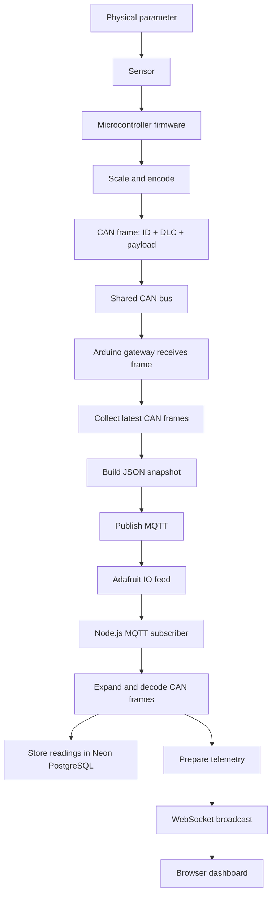

## 7.1 Gateway snapshot format

The Arduino gateway groups CAN frames into one JSON message. A
simplified example:

``` json
{
  "t": 123,
  "f": [
    ["0x100", "03 24"],
    ["0x101", "07 08"],
    ["0x103", "01 12"]
  ]
}
```

-   `t` represents gateway uptime in seconds.
-   `f` is an array of CAN identifiers and hexadecimal payloads.
-   Each inner array contains one CAN ID and its payload bytes.

The gateway publishes a combined snapshot approximately every three
seconds, reducing the number of Adafruit IO data points compared with
publishing every CAN frame separately.

------------------------------------------------------------------------

# 8. MQTT and Adafruit IO

Adafruit IO acts as the MQTT broker/feed service between the embedded
gateway and the backend.

  Setting             Configuration
  ------------------- -----------------------------
  Broker              `io.adafruit.com`
  TLS port            `8883`
  Protocol            MQTT over TLS
  Feed                `vhms-can`
  Topic format        `<username>/feeds/vhms-can`
  Snapshot interval   Approximately 3 seconds

The gateway authenticates using the Adafruit IO username and key.
Credentials must remain private and must never be committed to the
public repository.

The backend subscribes to the same feed and processes incoming JSON
snapshots.

------------------------------------------------------------------------

# 9. Backend and Database

## 9.1 Node.js backend

The backend uses Node.js and Express to connect MQTT messages, decoded
sensor values, persistent storage, and dashboard clients.

**Responsibilities** 1. Connect to Adafruit IO. 2. Subscribe to the VHMS
MQTT feed. 3. Parse incoming snapshots. 4. Expand snapshots into
individual CAN frames. 5. Decode CAN identifiers and payload values. 6.
Insert readings into PostgreSQL. 7. Prepare the latest telemetry state.
8. Broadcast telemetry through WebSockets.

### Technologies

  Technology   Purpose
  ------------ -------------------------
  Node.js      JavaScript runtime
  Express      HTTP server
  MQTT.js      MQTT client
  `ws`         WebSocket communication
  `pg`         PostgreSQL client
  Neon         Hosted PostgreSQL
  Render       Backend deployment

## 9.2 Neon PostgreSQL

The backend stores decoded CAN readings in the `can_readings` table.

The insert operation records: - Timestamp - CAN ID - Source ECU - Signal
name - Decoded value - Unit - Data length code (DLC) - Raw CAN payload

This provides historical records in addition to the latest live
dashboard values.

## 9.3 Backend endpoints

  Endpoint               Purpose
  ---------------------- --------------------------------
  `/`                    Server status and latest data
  `/health`              Basic service health
  `/db-health`           Database connectivity check
  `/ws?role=dashboard`   Dashboard WebSocket connection

------------------------------------------------------------------------

# 10. Web Dashboard

The dashboard provides a browser-based interface for monitoring sensor
measurements and CAN communication.

### Dashboard capabilities

-   Live sensor cards.
-   Real-time telemetry charts.
-   CAN message table.
-   GPS status and location information.
-   Packet inspector.
-   Packet logger.
-   CSV export.
-   Demo mode.

The dashboard connects to the backend through a secure WebSocket
endpoint:

``` text
wss://<your-render-service>/ws?role=dashboard
```

The backend broadcasts decoded telemetry to connected dashboard clients.

```{=html}
<!-- Add screenshots after uploading them to images/. -->
```
```{=html}
<!--
### Dashboard overview
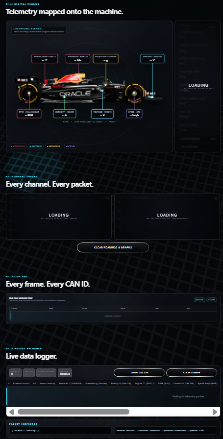

### Live telemetry
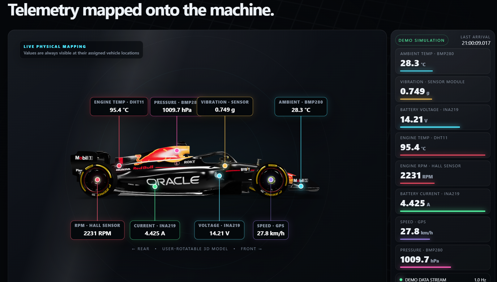

### CAN message monitor
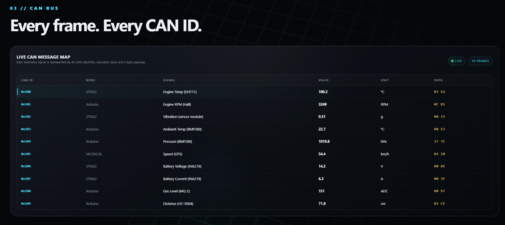
-->
```

------------------------------------------------------------------------

# 11. Repository Structure

``` text
Vehicle_Monitoring_System_CAN/
│
├── README.md
├── package.json
├── package-lock.json
├── server.js
├── canDecoder.js
├── test_decoder.js
├── index.html
├── Virtual_CAN_Simulation.py
├── Test_Readings_Graphs.py
│
├── images/
│   ├── arduino-uno-r4-wifi.jpg
│   ├── stm32-nucleo-f446re.jpg
│   ├── nxp-frdm-mcxn236.jpg
│   ├── mcp2515-can-module.jpg
│   ├── tja1050-transceiver.jpg
│   ├── dht11.jpg
│   ├── vibration-sensor.jpg
│   ├── ina219.jpg
│   ├── bmp280.jpg
│   ├── hall-effect-sensor.jpg
│   ├── mq-2.jpg
│   └── hc-sr04.jpg
│
└── firmware/
    ├── arduino_gateway/
    │   ├── arduino_gateway.ino
    │   └── config.example.h
    ├── stm32_node/
    │   └── stm32_node.ino
    └── nxp_frdm_mcxn236/
        ├── NXP_GUIDE.md
        ├── app.h
        ├── main.c
        ├── test_logic.c
        └── vhms_logic.h
```

------------------------------------------------------------------------

# 12. Setup and Deployment

## 12.1 Clone the repository

``` bash
git clone https://github.com/MadhavGarg362006/Vehicle_Monitoring_System_CAN.git
cd Vehicle_Monitoring_System_CAN
```

## 12.2 Install backend dependencies

``` bash
npm install
```

## 12.3 Configure environment variables

Create `.env.local` in the repository root:

``` env
MQTT_BROKER=mqtts://io.adafruit.com:8883
MQTT_USERNAME=YOUR_ADAFRUIT_USERNAME
MQTT_PASSWORD=YOUR_ADAFRUIT_IO_KEY
MQTT_TOPIC=YOUR_ADAFRUIT_USERNAME/feeds/vhms-can
DATABASE_URL=YOUR_NEON_DATABASE_URL
```

**Security:** Never commit `.env.local`, MQTT keys, database
credentials, or other secrets. Configure deployed credentials in
Render's environment-variable settings.

## 12.4 Run the backend locally

``` bash
npm install
node server.js
```

## 12.5 Flash the embedded nodes

### Arduino UNO R4 WiFi

1.  Open `firmware/arduino_gateway/arduino_gateway.ino`.
2.  Copy `config.example.h` to `config.h`.
3.  Add Wi-Fi and Adafruit IO configuration to `config.h`.
4.  Install the libraries required by the sketch.
5.  Select Arduino UNO R4 WiFi and upload.

### STM32 NUCLEO-F446RE

1.  Open `firmware/stm32_node/stm32_node.ino` in the configured Arduino
    IDE/STM32duino environment.
2.  Install the required sensor and MCP2515 libraries.
3.  Select NUCLEO-F446RE and upload.

### NXP FRDM-MCXN236

1.  Open the project files under `firmware/nxp_frdm_mcxn236/` using the
    matching MCUXpresso SDK and board configuration.
2.  Configure the required FlexCAN, UART and pin-mux settings.
3.  Build and flash using the NXP development environment.

## 12.6 Deploy the backend

1.  Create or select the Render web service.
2.  Configure the MQTT and Neon database environment variables.
3.  Deploy the repository.
4.  Confirm MQTT and PostgreSQL connections in the service logs.
5.  Point the dashboard WebSocket URL to the deployed backend.

------------------------------------------------------------------------

# 13. Prototype Validation

The VHMS prototype demonstrates the principal stages of the
embedded-to-cloud monitoring pipeline under prototype conditions.

  -----------------------------------------------------------------------
  Subsystem                           Prototype demonstration
  ----------------------------------- -----------------------------------
  STM32 sensor node                   DHT11, vibration module and INA219
                                      acquisition interfaces

  Arduino sensor node                 BMP280, Hall sensor, MQ-2 and
                                      HC-SR04 acquisition

  NXP node                            GPS acquisition and native CAN
                                      communication architecture

  CAN bus                             Multi-node communication at 500
                                      kbit/s

  CAN decoding                        Sensor-specific identifiers and
                                      big-endian payload decoding

  Gateway                             CAN frame collection and JSON
                                      snapshot generation

  MQTT                                Adafruit IO connection and repeated
                                      snapshot publishing

  Backend                             MQTT subscription and CAN frame
                                      processing

  Database                            PostgreSQL integration for decoded
                                      readings

  Dashboard                           WebSocket telemetry delivery and
                                      visualization
  -----------------------------------------------------------------------

### Observed prototype results

-   STM32 DHT11 temperature readings were observed around 27.1--27.4 °C
    during testing.
-   CAN reception on the Arduino was observed for IDs `0x101`, `0x103`,
    `0x104`, `0x108`, and `0x109`.
-   MCP2515 initialization and CAN communication were demonstrated.
-   The Arduino gateway connected to Adafruit IO and repeatedly
    published telemetry snapshots.
-   The Node.js backend implements MQTT reception, CAN decoding,
    PostgreSQL storage, and WebSocket broadcasting.

These observations describe prototype functionality. Measurement
accuracy depends on sensor characteristics, calibration, wiring, and
installation conditions.

------------------------------------------------------------------------

# 14. Measurement Notes

  -----------------------------------------------------------------------
  Signal                              Interpretation
  ----------------------------------- -----------------------------------
  DHT11 temperature                   Ambient/module temperature; not an
                                      automotive engine-temperature probe

  Vibration module                    Relative firmware-derived index;
                                      not calibrated acceleration

  INA219                              Voltage/current through the
                                      monitored electrical path

  BMP280                              Ambient temperature and atmospheric
                                      pressure; no humidity measurement

  Hall RPM                            Pulse-derived RPM using a
                                      one-pulse-per-revolution assumption

  MQ-2                                Raw ADC response; not calibrated
                                      ppm

  HC-SR04                             Ultrasonic distance; `4000` is the
                                      no-echo sentinel

  GPS                                 GPS-derived speed and position when
                                      a valid fix is available
  -----------------------------------------------------------------------

These distinctions are important when interpreting prototype telemetry.
Raw ADC counts, relative vibration indices, and demonstration
temperature readings should not be represented as calibrated automotive
measurements.

------------------------------------------------------------------------

# 15. Additional Photos to Add

The 12 component photographs listed in Section 4 are the component-reference images already embedded in this README. The following additional photographs are recommended to document the assembled prototype and software pipeline.

## 15.1 Physical prototype

| Filename | Photograph | Why it matters |
|---|---|---|
| `vhms-hardware-overview.jpg` | All three controllers, sensor modules and wiring together | Shows the assembled prototype in one view |

## 15.2 Software and cloud screenshots

| Filename | Screenshot | Why it matters |
|---|---|---|
| `dashboard-overview.png` | Full VHMS dashboard | Shows the final interface |
| `dashboard-live-telemetry.png` | Dashboard with live values and charts | Demonstrates live telemetry |
| `dashboard-can-messages.png` | CAN table or packet inspector | Shows CAN IDs and payloads |
| `adafruit-io-feed.png` | Adafruit IO `vhms-can` feed with incoming data | Shows the MQTT feed receiving snapshots |
| `neon-database-table.png` | Neon table view with `can_readings` rows | Shows persistent telemetry storage |
| `stm32-serial-monitor.png` | STM32 serial output | Shows sensor acquisition and node status |
| `arduino-serial-monitor.png` | Arduino serial output | Shows gateway and MQTT status |
| `nxp-serial-monitor.png` | NXP serial output | Shows GPS and CAN node status |

### Suggested gallery to add after taking the photos

```markdown
## Project Gallery

### Complete hardware prototype
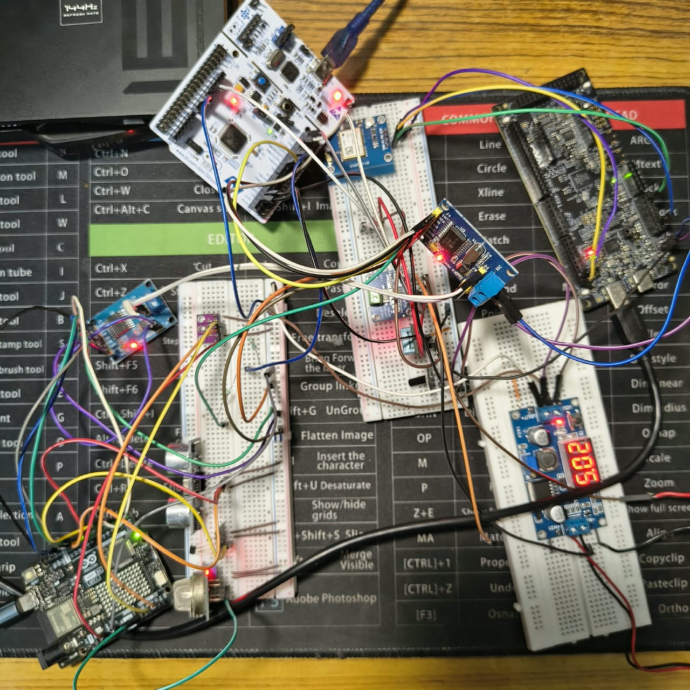

### Live monitoring dashboard


### Adafruit IO telemetry feed
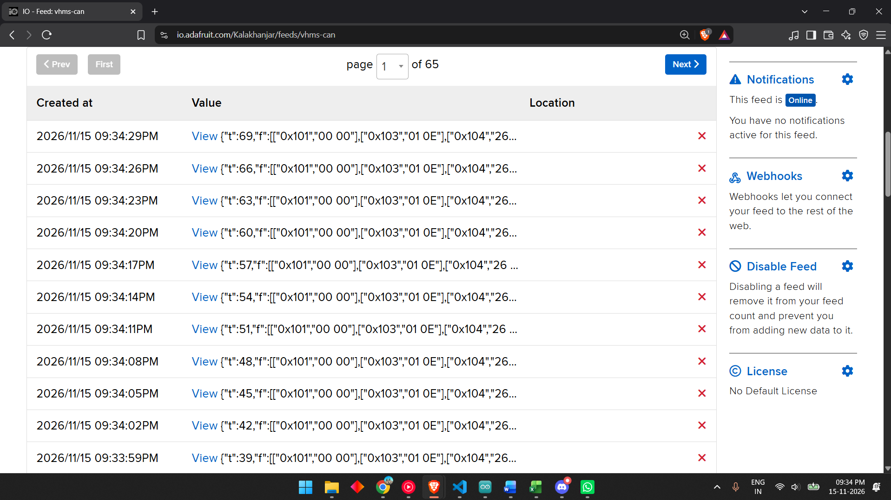

### Neon PostgreSQL records
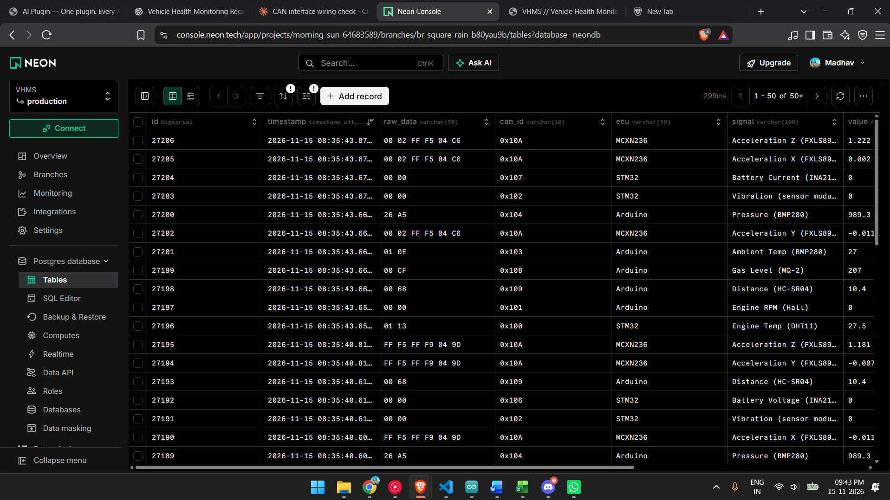
```

------------------------------------------------------------------------

# 16. Future Enhancements

-   Automotive-grade temperature and electrical sensors.
-   Calibrated vibration measurement.
-   Improved RPM calibration for different rotating targets.
-   Sensor fault detection and diagnostic codes.
-   Threshold-based alerts and event logging.
-   Historical trend analysis.
-   Predictive maintenance algorithms.
-   GPS route visualization.
-   Additional CAN nodes and vehicle parameters.
-   Improved buffering and network recovery.

------------------------------------------------------------------------

# 17. Disclaimer

This project is an educational and engineering prototype demonstrating
distributed embedded monitoring, CAN communication, sensor integration,
MQTT telemetry, cloud data processing, database storage, and real-time
visualization.

Prototype validation does not imply automotive certification or
qualification for safety-critical vehicle deployment.

------------------------------------------------------------------------

::: {align="center"}
**Vehicle Health Monitoring System**

*Embedded Systems • CAN Communication • IoT • Cloud Monitoring*

[GitHub
Repository](https://github.com/MadhavGarg362006/Vehicle_Monitoring_System_CAN)
:::
